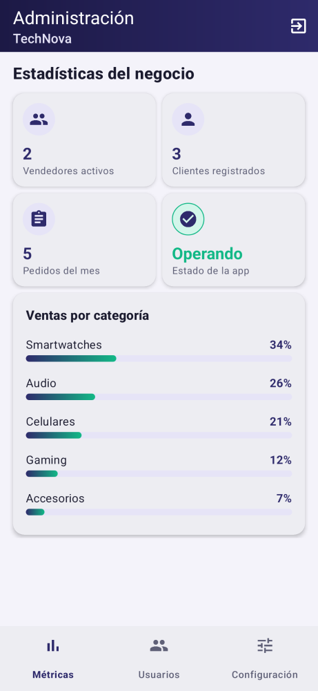

# TechNova — Tienda virtual de gadgets (Android nativo)

Aplicación móvil nativa en **Kotlin + XML** para la venta de tecnología y accesorios inteligentes en Colombia.
Proyecto de la asignatura **Desarrollo de Aplicaciones Móviles Nativas** — Fundación Universitaria Compensar.

**Autora:** Lizeth Marcela Duitama Ramos · lmduitama@ucompensar.edu.co

> Entrega actual (Actividad 4): **frontend completo de los 3 roles**. Los datos son de prueba
> (`FakeRepository`) y se reemplazarán por la API REST en la siguiente fase.

---

## Capturas

| Login | Catálogo (Comprador) | Panel Vendedor | Panel Administrador |
|---|---|---|---|
|  |  |  |  |

Más pantallas en [`docs/capturas`](docs/capturas).

## Roles y pantallas

| Rol | Pantallas |
|---|---|
| **Todos** | Inicio de sesión (con selector de rol), Registro (autorización Ley 1581 y términos Ley 527) |
| **Comprador** | Catálogo con búsqueda y filtro por categoría · Categorías · Detalle de producto · Carrito · Checkout (dirección y método de pago) · Pedido confirmado · Perfil (pedidos, PQR, aviso de privacidad, eliminar cuenta) |
| **Vendedor** | Inicio (indicadores, gráfico de ventas semanal, pedidos recientes) · Mis productos (editar / eliminar) · Formulario de producto (crear / editar) · Pedidos (filtro y cambio de estado) |
| **Administrador** | Métricas del negocio y ventas por categoría · Gestión de usuarios (filtro por rol, suspender / activar) · Configuración general (mantenimiento, notificaciones, costo de envío, pasarelas de pago) |

**Navegación:** cada rol tiene su propio `BottomNavigationView` (3 secciones con *fragments*) y una barra superior
(`MaterialToolbar`) con menú de opciones (carrito y cerrar sesión).

## Estructura del proyecto

```
app/src/main/
├── java/com/ucompensar/technova/
│   ├── data/            Modelos (Product, Order, User…) y FakeRepository (datos de prueba)
│   └── ui/
│       ├── auth/        LoginActivity, RegisterActivity
│       ├── buyer/       BuyerActivity + fragments, detalle, carrito, checkout
│       ├── seller/      SellerActivity + fragments, formulario de producto
│       ├── admin/       AdminActivity + fragments
│       └── common/      Formato de moneda (COP) y cierre de sesión
└── res/
    ├── layout/          activity_*, fragment_*, item_* (filas de listas), layout_* (bloques reutilizables con <include>)
    ├── drawable/        ic_* (íconos vectoriales) y bg_* (fondos con <shape>: degradados, bordes, etiquetas)
    ├── menu/            menu_*_nav (menús inferiores), menu_toolbar_* y menu_order_status (menú emergente)
    ├── color/           selectores de color según estado (seleccionado / no seleccionado)
    ├── values/          colors, dimens, strings, styles, themes, arrays
    └── values-night/    colores para modo oscuro
```

## Decisiones de diseño (XML)

- **Paleta propia** (no se usan los colores por defecto): índigo `#2E2A6B`, menta `#12B886`, coral `#FF6B4A` para precios y ámbar `#FFB020` para calificaciones. Definida en `values/colors.xml`.
- **Modo oscuro** (RNF-03): `values-night/colors.xml` redefine los mismos nombres de color.
- **Recursos centralizados**: ningún layout tiene textos, colores ni medidas escritos directamente; todo sale de `strings.xml`, `colors.xml` y `dimens.xml`.
- **Estilos reutilizables** en `styles.xml`: botones (`Widget.TechNova.Button`, `.Accent`, `.Outlined`, `.Text`), tarjetas, campos de texto, barra superior, menú inferior y tipografías (`Text.TechNova.Title`, `.Body`, `.Price`, `.Badge`…).
- **Accesibilidad** (RNF-03): áreas táctiles mínimas de 48dp (`@dimen/touch_min`) y `contentDescription` en imágenes.
- **Material Design 3** como tema base (`Theme.Material3.DayNight.NoActionBar`).
- **ViewBinding** para acceder a las vistas desde Kotlin sin `findViewById`.
- **R8 / ProGuard** activado en la versión *release* (RNF-02).

## Cómo ejecutarlo

1. Clonar el repositorio y abrirlo con **Android Studio** (Koala o superior).
2. Esperar la sincronización de Gradle.
3. Ejecutar en un emulador o celular con Android 7.0 (API 24) o superior.
4. En el login escribir cualquier correo válido y una contraseña de 6+ caracteres, elegir el rol y entrar.

**Generar el APK:** `Build > Build App Bundle(s) / APK(s) > Build APK(s)` o `./gradlew assembleDebug`
→ queda en `app/build/outputs/apk/debug/app-debug.apk`.

## Tecnologías

Kotlin 1.9 · Android Gradle Plugin 8.5 · compileSdk 34 · minSdk 24 · Material Components 1.12 · ConstraintLayout · RecyclerView · Fragments · ViewBinding

## Requerimientos cubiertos en esta entrega

| Requerimiento | Dónde |
|---|---|
| RF-01 Autenticación | `LoginActivity`, `RegisterActivity` |
| RF-02 Catálogo | `BuyerHomeFragment`, `BuyerCategoriesFragment`, `ProductDetailActivity` |
| RF-03 Carrito y checkout | `CartActivity`, `CheckoutActivity` |
| RF-04 Administración | `SellerProductsFragment`, `ProductFormActivity`, `SellerOrdersFragment`, `AdminUsersFragment` |
| RNF-03 Usabilidad | Material 3, 48dp, modo oscuro |
